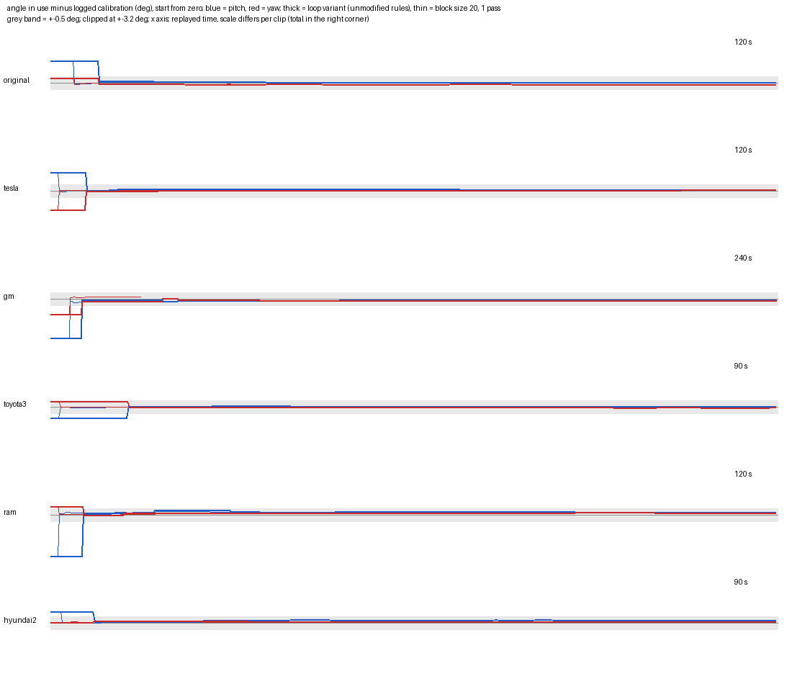
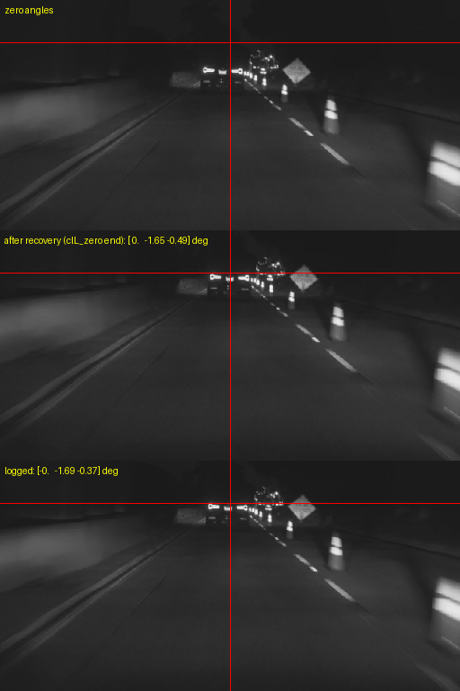

# Calibration recovery: openpilot's own estimator replayed on real footage (open loop)

Everything below was produced by the scripts in this directory on the six clips of `../real_footage/RESULTS.md` (600 frames each, both cameras, float32 model).
These are measurements, not a design recommendation.

## Limits that apply to every number
- **Open-loop replay of recorded driving.** The estimate is updated in a loop (warp with the estimate, run the model, feed its pose output to a port of `calibrationd`), but the car's path and the video are fixed. Driving outputs are compared with the logged-calibration run on the same frames.
- **Comma devices, not a phone.** Mounting, lenses and sensors differ from an iPhone on a dashboard mount. Nothing here measures an iPhone, its camera, its speed source or its mount.
- **"Truth" is the device's own logged calibration** (`extrinsicsCalibration.rpyCalib`; in the four older logs the same field as parsed with the master schema). It is another estimate made by the same method (an older model version in the logs), not a measured mounting angle. Agreement with it says the replay reproduces the device's estimate; any bias the model shares with the device's model is invisible here.
- One clip each, 30 s, on a stretch where the logged calibration is constant (moves at most 0.005 deg). Some clips are slow or turn a lot (gm: 162 of 600 frames pass the speed/yaw-rate gate).
- The model run is `models/driving_supercombo_fp32.onnx` (an older supercombo than the device's own at logging time), state from zeros, desire zeros, speed taken from the logged `carState.vEgo` (calibrationd reads vEgo; the iOS app today uses a fixed 15 m/s).
- Variants (block size 20, clip replayed in a loop) are labelled as variants; they are not openpilot's rules. The loop has a hard seam (frame 599 -> frame 0) with the model state and calibrator carried across it.

## What the source says (openpilot master, `openpilot/` prefix; files read from raw.githubusercontent.com, copies in the session scratch)
1. **Which outputs feed calibration.** `selfdrive/modeld/fill_model_msg.py: fill_pose_msg` builds `cameraOdometry` from `pose[0,:3]` (trans, m/s), `pose[0,3:]` (rot, rad/s), `wide_from_device_euler`, `road_transform[0,:3]` and the std of pose and road_transform (std = `safe_exp(raw)`, `parse_model_outputs.py: parse_mdn`). In the 2576-output layout those are raw slices 87..99 (6 mean + 6 log-std), 99..105 (3 + 3), 105..117 (6 + 6). `calibrationd.py: main` subscribes to `cameraOdometry` and `carState` and calls `Calibrator.handle_cam_odom(trans, rot, wideFromDeviceEuler, transStd, roadTransformTrans, roadTransformTransStd)` once per model step.
2. **Observation.** `calibrationd.py: handle_cam_odom`: `observed_rpy = [0, -arctan2(trans[2], trans[0]), arctan2(trans[1], trans[0])]`, then `new_rpy = euler_from_rot(rot_from_euler(get_smooth_rpy()) . rot_from_euler(observed_rpy))` and `sanity_clip` (pitch/yaw clipped to the validity limits plus 0.005 rad). Roll is never observed: `observed_rpy[0] = 0`, and the module docstring says roll is assumed zero and the network input is not corrected for roll.
3. **Frame of the model's reported motion.** `common/transformations/README.md`: "Calibrated ... This is the frame the model outputs are in". `modeld.py` builds the warp from the current `extrinsicsCalibration.rpyCalib` (`common/transformations/model.py: get_warp_matrix`: `camera_from_calib = K . view_from_device . device_from_calib`, `warp = camera_from_calib . calib_from_model`), so the model sees an image that is already rotated by the current estimate and reports its motion in that rotated frame. `locationd.py` converts the model's motion to the device frame with `device_from_calib @ trans` using the same rpyCalib, which is consistent with this. So the observation is a **residual relative to the angles in the warp**, and `handle_cam_odom` composes it onto the current estimate; the estimate converges rather than chases itself, as long as the model's report follows the warp. (`selfdrive/locationd/test/test_calibrationd.py` feeds `[v, sin(yaw) v, -sin(pitch) v]` with the estimate at zero, the same sign convention.) Confirmed by running, see "Frame check" below.
4. **Gating** (`calibrationd.py: handle_cam_odom`, constants at the top): a sample is used only if `carState.vEgo > 15 mph (6.7056 m/s)` and model `trans[0] > 6.7056 m/s` and `|rot[2]| < 2 deg/s`. Once `valid_blocks >= INPUTS_NEEDED (5)` it must additionally have `arctan2(transStd[1], trans[0]) < 0.25 deg` and `roadTransformTransStd[2] < exp(-3.5)` (about 0.030); before that these two are not checked.
5. **Smoothing and blocks.** A block is `BLOCK_SIZE = 100` accepted samples (5 s at 20 Hz, "at model frequency"). Inside a block `moving_avg_with_linear_decay(prev, new, idx, 100) = (idx*prev + (100-idx)*new)/100` is applied; by running the ported function (`test_calibrationd_port.py`) its effective weights put 0.97 of the weight on the last 25 samples of the block and 0.0000 on the first 50 (effective number of samples 21.7 of 100; 9.1 for block size 20). So a block value is roughly the mean of the last second of the block, not of the whole 5 s. The first completed block only **seeds**: `self.seeded` is set, `self.rpy = rpys[0]`, and the block index does not advance, so block 0 is overwritten by the next 100 samples. The angles are then `mean(rpys[completed blocks])` (`update_status`), up to `INPUTS_WANTED = 50` blocks kept.
6. **When it is "calibrated".** `update_status`: status `uncalibrated` until `valid_blocks >= 5` (`INPUTS_NEEDED`), then `calibrated` if `PITCH_LIMITS[0] < pitch < PITCH_LIMITS[1]` and `YAW_LIMITS` hold (pitch limits -8.2..12.7 deg for `mici`, -5.2..9.7 deg otherwise; yaw +-3.96 deg). Counting the seeding block that is `(1 + 5) * 100 = 600` accepted samples = 30 s of valid driving at the very least (`get_msg`: `calPerc = 100 * ((seeded + valid_blocks) * 100 + idx) // 600`). If the calibrated spread exceeds 4 deg pitch or 2 deg yaw the estimate is reset to the last block and blended over `SMOOTH_CYCLES = 10` steps ("abrupt transitions are not good for feedback loop through supercombo model").
7. **Publication and use.** `calibrationd.main` publishes `extrinsicsCalibration` when `sm.frame % 5 == 0`, i.e. every 5th camera-odometry message (4 Hz). `modeld.py` rebuilds both warp matrices only when `sm.updated["extrinsicsCalibration"]`. The replay does the same (angles in the warp change every 5th step, applied from the next frame).
8. **Roll and height.** Roll: not estimated (item 2). Height: `roadTransformTrans[2]` is averaged in blocks like the angles, published as `extrinsicsCalibration.height`, and only gates acceptance once calibrated (item 4); `get_warp_matrix` takes only angles and intrinsics, so height does not affect the model input in `modeld.py`. In the three older logs the device's own `cameraOdometry` has no `roadTransformTrans` (empty list), in which case calibrationd uses `HEIGHT_INIT = 1.22` and skips the height gate; our model outputs it, so the replay applies the gate.
9. **Wide camera.** `modeld.py` (lines 389-397) warps both cameras with the same `rpyCalib` and each camera's own intrinsics (`bigmodel_frame=True` for the wide one). `wide_from_device_euler` (model output) is averaged and published by calibrationd as `wideFromDeviceEuler`; in the files I read (`modeld.py`, `locationd.py`, `fill_model_msg.py`) nothing consumes it. I did not search the whole repository (no code search available), so "no consumer elsewhere" is not established.
10. **Port.** `cal_common.py: Calibrator` is a line-by-line port. `test_calibrationd_port.py` runs the cases of upstream `test_calibrationd.py` (basics, low speed, yaw rate, std rejects, auto reset) on it: all pass. The euler helpers equal upstream `transformations.py` (max abs diff 0).

## Verified by running
- **Harness reproduces the stored reference exactly**: the closed-loop harness with fixed logged angles gives max abs difference 0.0 over all 2576 outputs x 600 steps against `real_reference_fp32.npz` on all six clips (`reference_check_max_abs_diff_...` in `summary.json`). With 1, 2 and 4 onnxruntime threads the first 100 steps of the original clip are also bit identical (all runs here used 1 thread). A 4-loop run with logged angles reproduces the reference on its last pass (differences 0 to 1e-6; table "check" rows).
- **Frame / sign check** (table below; fixed warp angles = logged + offset, no feedback): with +2 deg yaw in the warp the model reports a direction of travel of about -1.9 deg yaw, i.e. it reports the opposite of the offset; the corrected angle (offset + observation) is within 0.1 deg of the logged one on the original clip (0.01 / 0.11 deg for +2 yaw). Same for pitch (+2 deg in the warp: observed -1.91). A 5 deg offset is corrected by 80-100 % in one observation (yaw about 80-85 %, pitch 96-100 % on the original clip). So the model's report follows the warp and the sign convention in `handle_cam_odom` corrects in the right direction. Exceptions: on **hyundai2** (and partly **gm**) negative yaw offsets are barely seen (fraction removed 0.15-0.22 on hyundai2, 0.47-0.65 on gm): the observation removes only part of a negative yaw offset (see table). Why was not investigated.
- **Warped frame before and after** (`warp_before_after.png`, original clip, frame 300, narrow luma): with zero angles the lead car's tail lights sit well above the model-frame principal-point row (red line, y = 47.6); after recovery (angles in use at the end of the 4-loop run, pitch -1.65 / yaw -0.49 deg) the picture matches the logged-angle warp (mean abs grey level difference 2.05, against 11.7 for zero angles).
- Noise floor per clip as in `phone_errors/noise_floor_check.py` (random +-1 grey level on the stored model inputs), measured in the single pass and in the loop setting (same value to within a few percent).

## Headline
**Does openpilot's own method recover the calibration from zero on these clips?** Yes, to within about 0.1-0.3 deg of the device's logged calibration, but not by the rules as written within 30 s, and not on every wrong start.
- **Unmodified rules, one 30 s pass, start from zero:** no clip ever reaches status `calibrated` (0 to 4 valid blocks at the end; `calibrated` needs 600 accepted samples = 30 s of valid driving at minimum, the clips offer 162 to 513). The first estimate is applied only after the first 100 accepted samples (5 s of valid driving; at step 103-201 of the clip), until then the warp keeps the start angles. After that the angles in use are within 0.05-0.26 deg pitch and 0.03-0.19 deg yaw of the logged ones at 30 s (start errors were 0.4-5.6 deg). Table "Experiment 2a".
- **Variant, clip replayed in a loop with unmodified constants:** `calibrated` after 30 s of valid driving (34-100 s of replayed time, depending on how much of the clip passes the gate; gm needs 100 s). The error stays below 0.5 deg from 5.0-5.3 s of valid driving on (7.8 s / 5.8 s / 10.3 s / 5.3 s / 5.3 s of clip time for original / tesla / gm / ram / hyundai2; toyota3's zero start was already within 1 deg). Settled error (mean over the last pass): pitch 0.04-0.21, yaw 0.06-0.15 deg. Block size 20 (variant, one pass): within 0.5 deg after 1.1-1.2 s of valid driving on all six clips (3.8 s of clip time on original, 6.3 s on gm, 1-1.3 s on the others; gm needs 5.2 s of valid driving for 0.25 deg), `calibrated` after 6.0 s of valid driving.
- **Wrong starts (+-2 and +-5 deg yaw or pitch):** after the loop the worst final error per clip is 0.06-0.34 deg pitch and 0.10-0.67 deg yaw, with one exception: **hyundai2 with a negative yaw start (-2 and -5 deg) does not recover** (0.63 and 3.50 deg left after 90 s replayed; in the unmodified single pass 0.77 and 3.58). gm: yaw -2 needs 96 s of replayed time to stay within 0.5 deg, yaw -5 ends at 0.67 deg after 240 s (never within 0.5); in the unmodified single pass gm's yaw starts -2/+5/-5 never get within 0.5 deg. These are the clips where the observation itself barely reacts to a negative yaw offset (frame check table).
- **What is left in the driving outputs after settling (loop last pass vs logged-calibration run):** about 1.3 to 6 times the clip's own noise floor (most entries 2-6), against 5 to 117 times for the fixed zero calibration. Per clip, mean abs difference, settled / fixed zero: curvature 1.3e-4 / 3.2e-4 (original), 1.3e-4 / 3.0e-3 (tesla), 5.4e-4 / 2.5e-3 (gm), 2.3e-5 / 1.0e-4 (toyota3), 3.4e-4 / 1.3e-3 (ram), 1.4e-4 / 4.0e-4 (hyundai2) 1/m; desired acceleration 0.034 / 0.49, 0.054 / 0.33, 0.023 / 0.11, 0.0097 / 0.069, 0.058 / 0.24, 0.040 / 0.20 m/s^2. The residual is the 0.05-0.2 deg angle error plus the model's own noise; it was not separated further. In the unmodified single pass the window (steps 100-599) includes the first 5-10 s with the start angles, so it is worse than the settled numbers (second-last rows of each clip table).
- **Roll and height:** roll is never estimated (observation roll = 0); in these clips the logged roll is 0.00-0.01 deg, so nothing can be measured about roll recovery. A roll tilt of a mount would stay in the image and in the model input (phone_errors measured outputs for +-2 deg roll: small). Height is estimated by the model (road_transform z: 1.21-1.58 m against the device's logged 1.20-1.30 where logged) and averaged, but is only a gate and does not enter the warp.
- **Single observation noise (experiment 1, logged-calibration run):** per-frame observation minus logged: pitch std 0.07-0.24 deg, yaw std 0.03-0.23 deg on gated frames, bias -0.05..+0.18 deg pitch and -0.03..+0.09 deg yaw; the device's own odometry (a different model version) shows the same bias and noise (e.g. ram pitch bias 0.18 vs 0.13). Frames that do not pass the gate (turns) have yaw errors up to 2.5 deg std (gm), which is what the yaw-rate gate removes.

## Read from the source versus run versus inferred
- **Read** (cited above): everything in "What the source says".
- **Run:** harness exactness, sign/frame check, all tables, the port's agreement with upstream's tests, the block weights, the warped-frame check.
- **Inferred, not tested:** that a phone with a different mount/lens would behave like these devices; that the settled residual is mostly the 0.05-0.2 deg angle error; why hyundai2/gm barely observe negative yaw offsets (hyundai2: night, lane line on one side only, per `../real_footage/RESULTS.md`; not tested); that `wideFromDeviceEuler` has no consumer outside the three files read.

## Skipped, failed, limitations
- A first run of the hyundai2 batch lost one of four worker processes to a race while compiling the shared library (`file too short`); fixed (per-process file + rename) and the missing tasks were re-run after re-decoding the clip. The affected results are all from complete runs; no partial file was used.
- The unmodified rules cannot declare `calibrated` inside 600 frames on any clip (stated above); that is a property of the constants, the loop variant exists to show the dynamics after that point.
- gm: with the unmodified rules the std gate (`transStd` angle < 0.25 deg, median here 0.35 deg; only 5 of 162 gated frames pass) rejects almost everything once 5 blocks are valid (gated samples per pass in the loop run: 163, 164, 165, 114, 11, 11, 11, 11), so the estimate freezes at what the first blocks gave; gm's final error is 0.08 / 0.12 deg.
- Roll, camera height and the wide camera's own mounting angle are not estimated or corrected by any of the logic replayed; I did not invent an estimator for them.
- The wide camera is warped with the narrow camera's `rpyCalib` (as `modeld.py` does). The device's own `wideFromDeviceEuler` (wide camera relative to the device) is a different quantity and differs from `rpyCalib` by up to 4.7 deg pitch (ram: 0.9 vs 5.6 deg); it is not used in the warp, and the effect of that was not measured here (the replay uses one angle triple for both cameras like the earlier experiments).
- Seam of the loop (frame 599 -> 0) is a hard cut for the model state; the same cut is in the logged-angle baseline, so differences are like for like, but absolute estimate noise near the seam was not examined.
- 600-frame clips only; no clip contains a mounting change; the spread/reset logic was exercised only by the upstream unit cases, not by data.
- The device's logged calibration of the four older clips was parsed with the master schema (status field unreliable there; angles agree with `real_footage`); the device's older calibrationd may have had different constants.

## Files and how to run
`extract_cal_log.py` (cameraOdometry, extrinsics/live calibration, carState from the rlog), `cal_common.py` (Calibrator port, warp, model runner, closed-loop `replay`), `test_calibrationd_port.py`, `obs_check.py` (experiment 1, needs no video), `decode_clip.sh`, `run_clip.py` (all replays of one clip, `CAL_CLIP_DIR`, `CAL_LOOPS`), `run_all_clips.sh` (the driver used), `analyze.py` (per-clip `summary.json`), `report.py` (the tables below), `view_frames.py`. All data (video, frames, npz, pickles) stays under `<clip>/calibration/`; run with the project python and `-I`. Loops used: original 4, tesla 4, gm 8, toyota3 3, ram 4, hyundai2 3 (chosen so that about 1300+ accepted samples are available). Plots: `estimate_vs_time.png` (angle in use minus logged, from zero; thick = loop variant, thin = block size 20), `warp_before_after.png`.

# Full tables (generated by `report.py`)

### Summary across clips (start from zero; ratios are mean abs difference to the logged-calibration run divided by the clip's own +-1 grey level noise floor)
| clip | unmodified, 30 s pass: error at 30 s (pitch / yaw deg), valid blocks, status | loop variant: first 'calibrated' (valid driving) | loop variant: settled error, mean over last pass (pitch / yaw deg) | worst final error over the 8 wrong starts, loop variant (pitch / yaw deg) | driving diff / noise floor after settling: curvature / accel / plan x 10 s / plan y 10 s / lane prob | same for fixed zero calibration |
| --- | --- | --- | --- | --- | --- | --- |
| original | 0.09 / -0.11, 2 blocks, uncalibrated | 50 s (30 s) | 0.04 / 0.12 | 0.06 / 0.26 | 2.8 / 2.1 / 2.3 / 1.9 / 1.3 | 7.1 / 34.1 / 19.3 / 6.2 / 5.0 |
| tesla | 0.15 / 0.03, 2 blocks, uncalibrated | 41 s (30 s) | 0.11 / 0.06 | 0.14 / 0.19 | 5.1 / 4.2 / 2.8 / 3.9 / 3.2 | 116.9 / 24.4 / 15.5 / 6.7 / 11.1 |
| gm | -0.07 / -0.19, 0 blocks, uncalibrated | 100 s (30 s) | 0.08 / 0.12 | 0.19 / 0.67 | 2.8 / 2.9 / 2.9 / 2.3 / 3.1 | 13.2 / 13.8 / 14.5 / 8.9 / 12.5 |
| toyota3 | 0.05 / -0.04, 4 blocks, uncalibrated | 39 s (30 s) | 0.05 / 0.06 | 0.06 / 0.10 | 5.4 / 3.6 / 4.4 / 3.9 / 2.0 | 25.4 / 27.0 / 23.5 / 10.5 / 5.0 |
| ram | 0.26 / 0.16, 3 blocks, uncalibrated | 41 s (30 s) | 0.21 / 0.15 | 0.20 / 0.22 | 5.9 / 4.1 / 4.8 / 3.8 / 4.7 | 18.9 / 17.2 / 17.1 / 21.7 / 14.9 |
| hyundai2 | 0.24 / 0.09, 4 blocks, uncalibrated | 34 s (30 s) | 0.20 / 0.08 | 0.34 / 3.50 | 5.9 / 4.0 / 4.3 / 6.2 / 5.0 | 16.9 / 19.3 / 8.0 / 8.3 / 11.6 |

### Clips and gating (logged-calibration reference run, one 600-step pass)
| clip | device / sensor | logged calibration at frame 0: roll / pitch / yaw (deg) | frames with speed + yaw-rate gate met (of 600) | of those in steps 100-599 | also trans-angle std < 0.25 deg | median trans-angle std (deg) | loops used in the loop variant |
| --- | --- | --- | --- | --- | --- | --- | --- |
| original | mici/mici / os04c10 | -0.001 / -1.691 / -0.366 | 337 | 289 | 269 | 0.127 | 4 |
| tesla | mici/mici / os04c10 | -0.010 / -1.438 / 1.447 | 393 | 302 | 149 | 0.078 | 4 |
| gm | unknown/tici / ox03c10 | -0.007 / 3.029 / 1.220 | 162 | 162 | 5 | 0.346 | 8 |
| toyota3 | tizi/tizi / ox03c10 | -0.003 / 0.884 / -0.436 | 502 | 449 | 488 | 0.080 | 3 |
| ram | unknown/tici / ox03c10 | 0.002 / 5.609 / -0.660 | 417 | 317 | 349 | 0.080 | 4 |
| hyundai2 | unknown/tici / ar0231 | 0.003 / -0.840 / -0.016 | 513 | 417 | 421 | 0.127 | 3 |

### Experiment 1: one observation versus the logged calibration (reference run, steps 100-599, gated frames; degrees; observation minus logged)
| clip | n gated | pitch bias | pitch std | yaw bias | yaw std | block-of-100 means (pitch, yaw) | device odometry: n / pitch bias / std / yaw bias / std | corr ours vs device (pitch / yaw) |
| --- | --- | --- | --- | --- | --- | --- | --- | --- |
| original | 289 | 0.038 | 0.081 | -0.029 | 0.103 | (0.04, -0.08); (0.07, -0.03) | 291 / 0.037 / 0.091 / -0.016 / 0.108 | 0.78 / 0.98 |
| tesla | 302 | 0.109 | 0.073 | 0.060 | 0.076 | (0.11, 0.03); (0.09, 0.12); (0.13, 0.03) | 302 / 0.119 / 0.070 / 0.055 / 0.076 | 0.88 / 0.91 |
| gm | 162 | -0.046 | 0.185 | -0.009 | 0.225 | (-0.13, 0.06) | 162 / -0.038 / 0.234 / 0.000 / 0.262 | 0.64 / 0.99 |
| toyota3 | 449 | 0.014 | 0.076 | -0.021 | 0.031 | (0.00, -0.03); (0.03, -0.01); (0.01, -0.04); (-0.00, 0.00) | 458 / 0.011 / 0.058 / -0.021 / 0.028 | 0.85 / 0.60 |
| ram | 317 | 0.181 | 0.242 | 0.086 | 0.151 | (0.19, 0.02); (0.32, 0.06); (0.06, 0.20) | 319 / 0.125 / 0.276 / 0.029 / 0.154 | 0.85 / 0.99 |
| hyundai2 | 417 | 0.151 | 0.172 | -0.002 | 0.116 | (0.06, -0.04); (0.13, 0.06); (0.11, -0.00); (0.27, -0.02) | 408 / 0.106 / 0.193 / -0.024 / 0.144 | 0.70 / 0.71 |

All frames (no gating) steps 100-599, yaw std: original 0.44 deg; tesla 0.13 deg; gm 2.53 deg; toyota3 0.03 deg; ram 1.72 deg; hyundai2 0.19 deg

Model speed (pose trans x) minus carState.vEgo, steps 100-599 mean (m/s): original 0.23; tesla 0.19; gm 0.18; toyota3 -0.11; ram -0.31; hyundai2 0.42

Height and wide-camera outputs (steps 100-599 means): 
| clip | model road_transform z (m) | logged height (m) | model wide_from_device_euler pitch / yaw (deg) | logged wideFromDeviceEuler pitch / yaw (deg) | logged rpyCalib pitch / yaw (deg) |
| --- | --- | --- | --- | --- | --- |
| original | 1.317 | 1.283 | -0.51 / -0.44 | -0.58 / -0.39 | -1.69 / -0.37 |
| tesla | 1.355 | 1.297 | 0.80 / -1.33 | 0.57 / -1.05 | -1.44 / 1.45 |
| gm | 1.349 | - | 1.44 / -0.06 | 2.04 / 0.50 | 3.03 / 1.22 |
| toyota3 | 1.208 | 1.200 | 0.07 / -1.20 | -0.10 / -1.07 | 0.88 / -0.44 |
| ram | 1.576 | - | 0.55 / 0.11 | 0.92 / 0.53 | 5.61 / -0.66 |
| hyundai2 | 1.319 | - | -0.50 / -1.18 | -0.74 / -1.16 | -0.84 / -0.02 |

### Frame / sign check: fixed warp angles = logged + offset, no feedback (steps 100-599, gated frames, medians; degrees)
| clip | offset in warp | observed pitch / yaw of travel | observation corrected angle minus logged (pitch / yaw) | fraction of the offset removed by one observation |
| --- | --- | --- | --- | --- |
| original | pitch+2 (2.00) | -1.91 / 0.02 | 0.09 / 0.02 | 0.956 |
| original | pitch+5 (5.00) | -4.99 / -0.07 | 0.01 / -0.07 | 0.997 |
| original | pitch-2 (-2.00) | 2.04 / -0.03 | 0.04 / -0.03 | 1.021 |
| original | pitch-5 (-5.00) | 4.95 / -0.06 | -0.05 / -0.06 | 0.990 |
| original | yaw+2 (2.00) | 0.01 / -1.90 | 0.01 / 0.11 | 0.947 |
| original | yaw+5 (5.00) | -0.10 / -4.28 | -0.10 / 0.73 | 0.855 |
| original | yaw-2 (-2.00) | 0.07 / 1.88 | 0.08 / -0.11 | 0.944 |
| original | yaw-5 (-5.00) | 0.02 / 4.01 | 0.03 / -0.98 | 0.804 |
| tesla | pitch+2 (2.00) | -1.81 / 0.09 | 0.19 / 0.09 | 0.907 |
| tesla | pitch+5 (5.00) | -5.06 / 0.25 | -0.06 / 0.25 | 1.012 |
| tesla | pitch-2 (-2.00) | 2.08 / 0.10 | 0.08 / 0.11 | 1.040 |
| tesla | pitch-5 (-5.00) | 5.03 / 0.02 | 0.03 / 0.02 | 1.005 |
| tesla | yaw+2 (2.00) | 0.06 / -1.75 | 0.06 / 0.25 | 0.875 |
| tesla | yaw+5 (5.00) | -0.10 / -4.14 | -0.10 / 0.86 | 0.829 |
| tesla | yaw-2 (-2.00) | 0.12 / 1.99 | 0.12 / -0.01 | 0.997 |
| tesla | yaw-5 (-5.00) | 0.02 / 4.20 | 0.03 / -0.79 | 0.841 |
| gm | pitch+2 (2.00) | -1.98 / -0.07 | 0.02 / -0.07 | 0.990 |
| gm | pitch+5 (5.00) | -5.13 / -0.18 | -0.13 / -0.18 | 1.025 |
| gm | pitch-2 (-2.00) | 1.87 / -0.18 | -0.12 / -0.18 | 0.938 |
| gm | pitch-5 (-5.00) | 4.77 / -0.04 | -0.23 / -0.04 | 0.954 |
| gm | yaw+2 (2.00) | -0.14 / -2.17 | -0.14 / -0.17 | 1.085 |
| gm | yaw+5 (5.00) | -0.38 / -4.55 | -0.39 / 0.45 | 0.911 |
| gm | yaw-2 (-2.00) | -0.09 / 0.93 | -0.09 / -1.07 | 0.467 |
| gm | yaw-5 (-5.00) | -0.30 / 3.24 | -0.30 / -1.75 | 0.650 |
| toyota3 | pitch+2 (2.00) | -1.99 / -0.08 | 0.01 / -0.08 | 0.995 |
| toyota3 | pitch+5 (5.00) | -4.99 / 0.07 | 0.01 / 0.07 | 0.998 |
| toyota3 | pitch-2 (-2.00) | 1.98 / -0.04 | -0.01 / -0.04 | 0.993 |
| toyota3 | pitch-5 (-5.00) | 5.00 / -0.04 | 0.00 / -0.04 | 1.001 |
| toyota3 | yaw+2 (2.00) | 0.03 / -2.01 | 0.03 / -0.01 | 1.004 |
| toyota3 | yaw+5 (5.00) | -0.00 / -4.07 | -0.00 / 0.93 | 0.813 |
| toyota3 | yaw-2 (-2.00) | 0.04 / 1.92 | 0.04 / -0.08 | 0.961 |
| toyota3 | yaw-5 (-5.00) | 0.12 / 3.89 | 0.12 / -1.11 | 0.778 |
| ram | pitch+2 (2.00) | -1.72 / 0.05 | 0.28 / 0.05 | 0.860 |
| ram | pitch+5 (5.00) | -5.03 / 0.17 | -0.03 / 0.17 | 1.006 |
| ram | pitch-2 (-2.00) | 2.21 / 0.03 | 0.21 / 0.04 | 1.106 |
| ram | pitch-5 (-5.00) | 5.15 / 0.06 | 0.16 / 0.06 | 1.032 |
| ram | yaw+2 (2.00) | 0.14 / -1.86 | 0.14 / 0.13 | 0.934 |
| ram | yaw+5 (5.00) | 0.07 / -4.11 | 0.07 / 0.87 | 0.826 |
| ram | yaw-2 (-2.00) | 0.17 / 1.87 | 0.18 / -0.12 | 0.939 |
| ram | yaw-5 (-5.00) | 0.22 / 4.00 | 0.21 / -0.97 | 0.805 |
| hyundai2 | pitch+2 (2.00) | -1.68 / 0.01 | 0.32 / 0.01 | 0.840 |
| hyundai2 | pitch+5 (5.00) | -4.67 / 0.01 | 0.33 / 0.01 | 0.934 |
| hyundai2 | pitch-2 (-2.00) | 1.99 / -0.13 | -0.01 / -0.12 | 0.995 |
| hyundai2 | pitch-5 (-5.00) | 4.96 / -0.15 | -0.04 / -0.15 | 0.993 |
| hyundai2 | yaw+2 (2.00) | 0.08 / -1.80 | 0.08 / 0.21 | 0.897 |
| hyundai2 | yaw+5 (5.00) | -0.11 / -4.23 | -0.11 / 0.77 | 0.845 |
| hyundai2 | yaw-2 (-2.00) | -0.02 / 0.44 | -0.02 / -1.56 | 0.220 |
| hyundai2 | yaw-5 (-5.00) | -0.15 / 0.64 | -0.15 / -4.23 | 0.154 |

Fixed zero warp (the iOS app today), same quantities:
| clip | start error pitch / yaw (zero minus logged) | observed pitch / yaw | corrected minus logged |
| --- | --- | --- | --- |
| original | 1.69 / 0.37 | -1.60 / -0.36 | 0.09 / 0.01 |
| tesla | 1.44 / -1.45 | -1.29 / 1.49 | 0.15 / 0.05 |
| gm | -3.03 / -1.22 | 2.85 / 0.98 | -0.18 / -0.24 |
| toyota3 | -0.88 / 0.44 | 0.91 / -0.47 | 0.03 / -0.03 |
| ram | -5.61 / 0.66 | 5.77 / -0.54 | 0.17 / 0.12 |
| hyundai2 | 0.84 / 0.02 | -0.36 / 0.02 | 0.47 / 0.03 |

### Experiment 2a: calibrationd's unmodified rules, one 30 s pass, start from zero (angle in use minus logged, pitch / yaw deg)
| clip | start error | at 5 s | 10 s | 15 s | 20 s | 30 s | gated samples in the pass | valid blocks at end | status at end (calPerc) | seeded at step |
| --- | --- | --- | --- | --- | --- | --- | --- | --- | --- | --- |
| original | 1.69 / 0.37 | 1.69 / 0.37 | 0.16 / -0.08 | 0.16 / -0.08 | 0.11 / -0.09 | 0.09 / -0.11 | 339 | 2 | uncalibrated (56 %) | 151 |
| tesla | 1.44 / -1.45 | 1.44 / -1.45 | 0.05 / -0.05 | 0.16 / -0.02 | 0.15 / 0.03 | 0.15 / 0.03 | 387 | 2 | uncalibrated (64 %) | 115 |
| gm | -3.03 / -1.22 | -3.03 / -1.22 | -3.03 / -1.22 | -0.07 / -0.19 | -0.07 / -0.19 | -0.07 / -0.19 | 163 | 0 | uncalibrated (27 %) | 201 |
| toyota3 | -0.88 / 0.44 | -0.88 / 0.44 | 0.04 / -0.04 | 0.05 / -0.03 | 0.07 / -0.04 | 0.05 / -0.04 | 506 | 4 | uncalibrated (84 %) | 189 |
| ram | -5.61 / 0.66 | -5.61 / 0.66 | 0.11 / -0.03 | 0.15 / 0.16 | 0.36 / 0.15 | 0.26 / 0.16 | 413 | 3 | uncalibrated (68 %) | 103 |
| hyundai2 | 0.84 / 0.02 | 0.84 / 0.02 | 0.09 / 0.14 | 0.10 / 0.14 | 0.18 / 0.14 | 0.24 / 0.09 | 512 | 4 | uncalibrated (85 %) | 103 |

### Experiment 2b: VARIANT block size 20 (instead of 100), one 30 s pass, start from zero
| clip | gated samples | valid blocks at end | status at end | stays within 1.0 deg | stays within 0.5 deg | stays within 0.25 deg | error at end, pitch / yaw (deg) | first 'calibrated' |
| --- | --- | --- | --- | --- | --- | --- | --- | --- |
| original | 285 | 13 | calibrated | 3.8 s (1.2 s valid) | 3.8 s (1.2 s valid) | 3.8 s (1.2 s valid) | 0.04 / -0.11 | 8.6 s (6.0 s valid) |
| tesla | 207 | 9 | calibrated | 1.3 s (1.1 s valid) | 1.3 s (1.1 s valid) | 1.3 s (1.1 s valid) | 0.07 / 0.04 | 6.9 s (6.0 s valid) |
| gm | 121 | 5 | calibrated | 6.3 s (1.2 s valid) | 6.3 s (1.2 s valid) | 10.3 s (5.2 s valid) | -0.17 / 0.11 | 11.1 s (6.0 s valid) |
| toyota3 | 495 | 23 | calibrated | 0.0 s (0.0 s valid) | 1.1 s (1.1 s valid) | 1.1 s (1.1 s valid) | -0.00 / -0.05 | 10.9 s (6.0 s valid) |
| ram | 366 | 17 | calibrated | 1.3 s (1.1 s valid) | 1.3 s (1.1 s valid) | 1.3 s (1.1 s valid) | 0.19 / 0.09 | 6.2 s (6.0 s valid) |
| hyundai2 | 411 | 19 | calibrated | 0.0 s (0.0 s valid) | 1.3 s (1.1 s valid) | 1.3 s (1.1 s valid) | 0.17 / 0.04 | 6.2 s (6.0 s valid) |

### Experiment 2c: VARIANT clip replayed in a loop (unmodified constants), start from zero
| clip | passes | gated samples per pass | first 'calibrated' (replayed time, valid driving) | stays within 1.0 deg | stays within 0.5 deg | stays within 0.25 deg | error at end, pitch / yaw (deg) | last pass: mean |error| pitch / yaw (deg) | last pass: max |error| pitch / yaw |
| --- | --- | --- | --- | --- | --- | --- | --- | --- | --- |
| original | 4 | 339/300.. | 50 s (30 s) | 7.8 s (5.2 s valid) | 7.8 s (5.2 s valid) | 7.8 s (5.2 s valid) | 0.05 / -0.12 | 0.04 / 0.12 | 0.05 / 0.12 |
| tesla | 4 | 387/252.. | 41 s (30 s) | 5.8 s (5.0 s valid) | 5.8 s (5.0 s valid) | 5.8 s (5.0 s valid) | 0.11 / 0.06 | 0.11 / 0.06 | 0.11 / 0.06 |
| gm | 8 | 163/164.. | 100 s (30 s) | 10.3 s (5.2 s valid) | 10.3 s (5.2 s valid) | 10.3 s (5.2 s valid) | -0.08 / -0.12 | 0.08 / 0.12 | 0.08 / 0.12 |
| toyota3 | 3 | 506/497.. | 39 s (30 s) | 0.0 s (0.0 s valid) | 9.6 s (5.0 s valid) | 9.6 s (5.0 s valid) | 0.05 / -0.06 | 0.05 / 0.06 | 0.05 / 0.06 |
| ram | 4 | 413/385.. | 41 s (30 s) | 5.3 s (5.1 s valid) | 5.3 s (5.1 s valid) | 60.3 s (40.0 s valid) | 0.20 / 0.16 | 0.21 / 0.15 | 0.22 / 0.17 |
| hyundai2 | 3 | 512/358.. | 34 s (30 s) | 0.0 s (0.0 s valid) | 5.3 s (5.1 s valid) | 5.3 s (5.1 s valid) | 0.21 / 0.06 | 0.20 / 0.08 | 0.21 / 0.09 |

Angle in use minus logged (pitch / yaw, deg) at checkpoints, loop variant from zero:
| clip | 30 s | 60 s | 90 s | 120 s | 150 s | 180 s | 240 s |
| --- | --- | --- | --- | --- | --- | --- | --- |
| original | 0.09 / -0.11 | 0.04 / -0.12 | 0.04 / -0.12 | 0.05 / -0.12 | - | - | - |
| tesla | 0.15 / 0.03 | 0.12 / 0.05 | 0.11 / 0.05 | 0.11 / 0.06 | - | - | - |
| gm | -0.07 / -0.19 | -0.13 / -0.10 | -0.15 / -0.13 | -0.08 / -0.12 | -0.08 / -0.12 | -0.08 / -0.12 | -0.08 / -0.12 |
| toyota3 | 0.05 / -0.04 | 0.05 / -0.05 | 0.05 / -0.06 | - | - | - | - |
| ram | 0.26 / 0.16 | 0.27 / 0.16 | 0.21 / 0.18 | 0.20 / 0.16 | - | - | - |
| hyundai2 | 0.24 / 0.09 | 0.22 / 0.09 | 0.21 / 0.06 | - | - | - | - |

### Experiment 3: starts off by 2 and 5 degrees (VARIANT block size 20, one 30 s pass): start error -> error at end of run (pitch / yaw, deg); time the error stays below 0.5 deg
| clip | zero | yaw+2 | yaw-2 | yaw+5 | yaw-5 | pitch+2 | pitch-2 | pitch+5 | pitch-5 |
| --- | --- | --- | --- | --- | --- | --- | --- | --- | --- |
| original | 1.7/0.4 -> 0.04 / -0.11 ; 4 s | 0.0/2.0 -> 0.04 / -0.03 ; 4 s | 0.0/-2.0 -> 0.04 / -0.17 ; 4 s | 0.0/5.0 -> 0.02 / -0.03 ; 5 s | 0.0/-5.0 -> 0.01 / -0.14 ; 4 s | 2.0/0.0 -> 0.04 / -0.09 ; 4 s | -2.0/0.0 -> 0.03 / -0.10 ; 4 s | 5.0/0.0 -> 0.04 / -0.10 ; 4 s | -5.0/0.0 -> 0.03 / -0.07 ; 4 s |
| tesla | 1.4/-1.4 -> 0.07 / 0.04 ; 1 s | 0.0/2.0 -> 0.06 / 0.04 ; 1 s | 0.0/-2.0 -> 0.07 / 0.02 ; 1 s | 0.0/5.0 -> 0.08 / 0.11 ; 3 s | 0.0/-5.0 -> 0.09 / 0.03 ; 3 s | 2.0/0.0 -> 0.06 / 0.04 ; 1 s | -2.0/0.0 -> 0.06 / 0.02 ; 1 s | 5.0/0.0 -> 0.06 / 0.07 ; 1 s | -5.0/0.0 -> 0.07 / 0.04 ; 1 s |
| gm | -3.0/-1.2 -> -0.17 / 0.11 ; 6 s | 0.0/2.0 -> -0.17 / 0.04 ; 6 s | 0.0/-2.0 -> -0.15 / -0.25 ; 6 s | 0.0/5.0 -> -0.16 / -0.11 ; 8 s | 0.0/-5.0 -> -0.17 / -0.38 ; 6 s | 2.0/0.0 -> -0.14 / 0.11 ; 6 s | -2.0/0.0 -> -0.17 / 0.16 ; 6 s | 5.0/0.0 -> -0.21 / -0.02 ; 8 s | -5.0/0.0 -> -0.19 / 0.19 ; 6 s |
| toyota3 | -0.9/0.4 -> -0.00 / -0.05 ; 1 s | 0.0/2.0 -> 0.00 / -0.06 ; 1 s | 0.0/-2.0 -> 0.00 / -0.15 ; 1 s | 0.0/5.0 -> 0.04 / 0.07 ; 2 s | 0.0/-5.0 -> -0.01 / -0.14 ; 2 s | 2.0/0.0 -> -0.01 / -0.12 ; 1 s | -2.0/0.0 -> -0.01 / -0.08 ; 1 s | 5.0/0.0 -> 0.01 / -0.04 ; 1 s | -5.0/0.0 -> 0.00 / -0.06 ; 1 s |
| ram | -5.6/0.7 -> 0.19 / 0.09 ; 1 s | 0.0/2.0 -> 0.19 / 0.08 ; 1 s | 0.0/-2.0 -> 0.20 / 0.04 ; 2 s | 0.0/5.0 -> 0.20 / 0.20 ; 3 s | 0.0/-5.0 -> 0.20 / 0.09 ; 3 s | 2.0/0.0 -> 0.19 / 0.08 ; 1 s | -2.0/0.0 -> 0.20 / 0.07 ; 1 s | 5.0/0.0 -> 0.19 / 0.11 ; 1 s | -5.0/0.0 -> 0.19 / 0.07 ; 1 s |
| hyundai2 | 0.8/0.0 -> 0.17 / 0.04 ; 1 s | 0.0/2.0 -> 0.12 / 0.21 ; 1 s | 0.0/-2.0 -> -0.08 / -0.74 ; never | 0.0/5.0 -> 0.12 / 0.29 ; 4 s | 0.0/-5.0 -> -0.61 / -4.14 ; never | 2.0/0.0 -> 0.17 / 0.11 ; 1 s | -2.0/0.0 -> 0.15 / 0.05 ; 1 s | 5.0/0.0 -> 0.12 / 0.19 ; 1 s | -5.0/0.0 -> 0.15 / 0.07 ; 1 s |

### Experiment 3: starts off by 2 and 5 degrees (VARIANT loop, unmodified constants): start error -> error at end of run (pitch / yaw, deg); time the error stays below 0.5 deg
| clip | zero | yaw+2 | yaw-2 | yaw+5 | yaw-5 | pitch+2 | pitch-2 | pitch+5 | pitch-5 |
| --- | --- | --- | --- | --- | --- | --- | --- | --- | --- |
| original | 1.7/0.4 -> 0.05 / -0.12 ; 8 s | 0.0/2.0 -> 0.04 / -0.04 ; 8 s | 0.0/-2.0 -> 0.06 / -0.15 ; 8 s | 0.0/5.0 -> 0.03 / 0.08 ; 17 s | 0.0/-5.0 -> 0.05 / -0.26 ; 16 s | 2.0/0.0 -> 0.04 / -0.11 ; 8 s | -2.0/0.0 -> 0.04 / -0.15 ; 8 s | 5.0/0.0 -> 0.03 / -0.13 ; 8 s | -5.0/0.0 -> 0.03 / -0.10 ; 8 s |
| tesla | 1.4/-1.4 -> 0.11 / 0.06 ; 6 s | 0.0/2.0 -> 0.14 / 0.11 ; 6 s | 0.0/-2.0 -> 0.10 / 0.06 ; 6 s | 0.0/5.0 -> 0.07 / 0.19 ; 12 s | 0.0/-5.0 -> 0.10 / 0.01 ; 11 s | 2.0/0.0 -> 0.12 / 0.09 ; 6 s | -2.0/0.0 -> 0.12 / 0.07 ; 6 s | 5.0/0.0 -> 0.12 / 0.19 ; 6 s | -5.0/0.0 -> 0.11 / 0.02 ; 6 s |
| gm | -3.0/-1.2 -> -0.08 / -0.12 ; 10 s | 0.0/2.0 -> -0.12 / -0.16 ; 10 s | 0.0/-2.0 -> -0.14 / -0.43 ; 96 s | 0.0/5.0 -> -0.13 / 0.06 ; 37 s | 0.0/-5.0 -> -0.19 / -0.67 ; never | 2.0/0.0 -> -0.05 / -0.04 ; 10 s | -2.0/0.0 -> -0.08 / -0.15 ; 10 s | 5.0/0.0 -> -0.09 / -0.15 ; 11 s | -5.0/0.0 -> -0.08 / 0.02 ; 10 s |
| toyota3 | -0.9/0.4 -> 0.05 / -0.06 ; 10 s | 0.0/2.0 -> 0.00 / -0.01 ; 7 s | 0.0/-2.0 -> 0.05 / -0.08 ; 10 s | 0.0/5.0 -> 0.00 / -0.08 ; 16 s | 0.0/-5.0 -> -0.02 / -0.10 ; 13 s | 2.0/0.0 -> 0.01 / -0.07 ; 11 s | -2.0/0.0 -> 0.06 / -0.04 ; 10 s | 5.0/0.0 -> 0.04 / -0.00 ; 10 s | -5.0/0.0 -> 0.03 / -0.06 ; 11 s |
| ram | -5.6/0.7 -> 0.20 / 0.16 ; 5 s | 0.0/2.0 -> 0.20 / 0.21 ; 5 s | 0.0/-2.0 -> 0.20 / 0.17 ; 5 s | 0.0/5.0 -> 0.20 / 0.22 ; 12 s | 0.0/-5.0 -> 0.19 / 0.18 ; 12 s | 2.0/0.0 -> 0.20 / 0.17 ; 5 s | -2.0/0.0 -> 0.20 / 0.16 ; 5 s | 5.0/0.0 -> 0.20 / 0.22 ; 5 s | -5.0/0.0 -> 0.20 / 0.16 ; 5 s |
| hyundai2 | 0.8/0.0 -> 0.21 / 0.06 ; 5 s | 0.0/2.0 -> 0.18 / 0.20 ; 5 s | 0.0/-2.0 -> 0.07 / -0.63 ; never | 0.0/5.0 -> 0.18 / 0.24 ; 14 s | 0.0/-5.0 -> -0.34 / -3.50 ; never | 2.0/0.0 -> 0.20 / 0.05 ; 5 s | -2.0/0.0 -> 0.19 / 0.03 ; 5 s | 5.0/0.0 -> 0.19 / 0.09 ; 5 s | -5.0/0.0 -> 0.18 / -0.01 ; 5 s |

### Experiment 3: starts off by 2 and 5 degrees (unmodified, one 30 s pass): start error -> error at end of run (pitch / yaw, deg); time the error stays below 0.5 deg
| clip | zero | yaw+2 | yaw-2 | yaw+5 | yaw-5 | pitch+2 | pitch-2 | pitch+5 | pitch-5 |
| --- | --- | --- | --- | --- | --- | --- | --- | --- | --- |
| original | 1.7/0.4 -> 0.09 / -0.11 ; 8 s | 0.0/2.0 -> 0.08 / -0.02 ; 8 s | 0.0/-2.0 -> 0.10 / -0.17 ; 8 s | 0.0/5.0 -> 0.04 / 0.15 ; 17 s | 0.0/-5.0 -> 0.15 / -0.40 ; 16 s | 2.0/0.0 -> 0.09 / -0.11 ; 8 s | -2.0/0.0 -> 0.08 / -0.16 ; 8 s | 5.0/0.0 -> 0.04 / -0.13 ; 8 s | -5.0/0.0 -> 0.05 / -0.09 ; 8 s |
| tesla | 1.4/-1.4 -> 0.15 / 0.03 ; 6 s | 0.0/2.0 -> 0.14 / 0.12 ; 6 s | 0.0/-2.0 -> 0.15 / 0.02 ; 6 s | 0.0/5.0 -> 0.10 / 0.24 ; 12 s | 0.0/-5.0 -> 0.19 / -0.08 ; 11 s | 2.0/0.0 -> 0.15 / 0.09 ; 6 s | -2.0/0.0 -> 0.15 / 0.06 ; 6 s | 5.0/0.0 -> 0.11 / 0.24 ; 6 s | -5.0/0.0 -> 0.15 / -0.02 ; 6 s |
| gm | -3.0/-1.2 -> -0.07 / -0.19 ; 10 s | 0.0/2.0 -> -0.05 / -0.22 ; 10 s | 0.0/-2.0 -> -0.04 / -0.76 ; never | 0.0/5.0 -> -0.24 / 0.55 ; never | 0.0/-5.0 -> -0.23 / -1.90 ; never | 2.0/0.0 -> 0.12 / -0.05 ; 10 s | -2.0/0.0 -> -0.03 / -0.21 ; 10 s | 5.0/0.0 -> -0.01 / -0.21 ; 11 s | -5.0/0.0 -> -0.26 / 0.00 ; 10 s |
| toyota3 | -0.9/0.4 -> 0.05 / -0.04 ; 10 s | 0.0/2.0 -> -0.00 / 0.01 ; 7 s | 0.0/-2.0 -> 0.04 / -0.07 ; 10 s | 0.0/5.0 -> 0.02 / -0.04 ; 16 s | 0.0/-5.0 -> 0.00 / -0.10 ; 13 s | 2.0/0.0 -> 0.01 / -0.05 ; 11 s | -2.0/0.0 -> 0.06 / -0.01 ; 10 s | 5.0/0.0 -> 0.07 / 0.03 ; 10 s | -5.0/0.0 -> 0.05 / -0.04 ; 11 s |
| ram | -5.6/0.7 -> 0.26 / 0.16 ; 5 s | 0.0/2.0 -> 0.26 / 0.26 ; 5 s | 0.0/-2.0 -> 0.26 / 0.16 ; 5 s | 0.0/5.0 -> 0.26 / 0.30 ; 12 s | 0.0/-5.0 -> 0.26 / 0.19 ; 12 s | 2.0/0.0 -> 0.27 / 0.18 ; 5 s | -2.0/0.0 -> 0.27 / 0.15 ; 5 s | 5.0/0.0 -> 0.26 / 0.30 ; 5 s | -5.0/0.0 -> 0.27 / 0.14 ; 5 s |
| hyundai2 | 0.8/0.0 -> 0.24 / 0.09 ; 5 s | 0.0/2.0 -> 0.18 / 0.27 ; 5 s | 0.0/-2.0 -> 0.03 / -0.77 ; never | 0.0/5.0 -> 0.18 / 0.31 ; 14 s | 0.0/-5.0 -> -0.37 / -3.58 ; never | 2.0/0.0 -> 0.22 / 0.08 ; 5 s | -2.0/0.0 -> 0.17 / -0.00 ; 5 s | 5.0/0.0 -> 0.19 / 0.10 ; 5 s | -5.0/0.0 -> 0.15 / -0.04 ; 5 s |

### Experiment 4: driving outputs versus the reference run with the logged calibration (mean abs difference over steps 100-599 of the pass; in brackets the worst step)

**original**

| case | curvature (1/m) | accel (m/s^2) | plan x 10 s (m) | plan y 10 s (m) | lane-line prob | lateral accel change (m/s^2, mean) | curvature signed mean (1/m) |
| --- | --- | --- | --- | --- | --- | --- | --- |
| noise floor: +-1 grey level random input noise, 1 pass | 4.5e-05 (0.00035) | 0.014 (0.086) | 1.3 (13) | 0.72 (5.4) | 0.011 (0.074) | 0.0094 | 2.5e-05 |
| noise floor in the loop setting (vs loop run with logged calibration) | 4.7e-05 (0.00038) | 0.016 (0.1) | 1.3 (13) | 0.8 (4.3) | 0.011 (0.074) | 0.0098 | 2.5e-05 |
| check: logged calibration, loop last pass vs reference | 0 (0) | 1.9e-08 (1.4e-06) | 0 (0) | 0 (0) | 0 (0) | 0 | 0 |
| zero calibration, fixed (iOS app today) | 0.00032 (0.0018) | 0.49 (0.95) | 25 (75) | 4.5 (23) | 0.054 (0.17) | 0.076 | -0.00019 |
| closed loop from zero, unmodified, 1 pass | 0.00013 (0.00081) | 0.14 (0.91) | 9.4 (75) | 3.1 (20) | 0.021 (0.14) | 0.032 | 9e-05 |
| closed loop from zero, block size 20, 1 pass | 0.00012 (0.00066) | 0.037 (0.19) | 3.2 (27) | 1.6 (13) | 0.013 (0.058) | 0.029 | 0.00011 |
| closed loop from zero, loop variant, last pass | 0.00013 (0.00067) | 0.034 (0.2) | 3.1 (33) | 1.5 (11) | 0.014 (0.057) | 0.033 | 0.00012 |
| loop variant, start yaw+2, last pass | 7.2e-05 (0.00042) | 0.026 (0.18) | 2.6 (33) | 1.3 (10) | 0.012 (0.066) | 0.017 | 5.3e-05 |
| loop variant, start yaw-2, last pass | 0.00016 (0.0008) | 0.036 (0.16) | 3.3 (21) | 1.7 (12) | 0.016 (0.076) | 0.04 | 0.00015 |
| loop variant, start yaw+5, last pass | 7.7e-05 (0.00042) | 0.027 (0.14) | 2.4 (36) | 1.2 (11) | 0.011 (0.048) | 0.019 | -6.1e-05 |
| loop variant, start yaw-5, last pass | 0.00025 (0.0011) | 0.045 (0.19) | 4 (29) | 2 (16) | 0.017 (0.095) | 0.065 | 0.00025 |
| loop variant, start pitch+2, last pass | 0.00013 (0.00066) | 0.034 (0.18) | 3.1 (32) | 1.5 (12) | 0.014 (0.057) | 0.032 | 0.00012 |
| loop variant, start pitch-2, last pass | 0.00016 (0.00074) | 0.033 (0.18) | 3.2 (41) | 1.7 (12) | 0.016 (0.082) | 0.04 | 0.00015 |
| loop variant, start pitch+5, last pass | 0.00013 (0.00073) | 0.024 (0.18) | 2.8 (28) | 1.6 (8.9) | 0.014 (0.071) | 0.034 | 0.00013 |
| loop variant, start pitch-5, last pass | 0.00012 (0.00071) | 0.027 (0.15) | 2.8 (27) | 1.5 (8.9) | 0.014 (0.057) | 0.03 | 0.00011 |
| fixed offset yaw+2, no recovery | 0.00077 (0.0039) | 0.06 (0.29) | 4.4 (23) | 4.3 (17) | 0.049 (0.17) | 0.19 | -0.00077 |
| fixed offset yaw-2, no recovery | 0.0014 (0.0035) | 0.099 (0.41) | 5.5 (20) | 3.3 (22) | 0.045 (0.14) | 0.34 | 0.0014 |
| fixed offset yaw+5, no recovery | 0.0021 (0.0053) | 0.29 (0.99) | 12 (55) | 12 (51) | 0.085 (0.19) | 0.64 | -0.002 |
| fixed offset yaw-5, no recovery | 0.0056 (0.0088) | 0.46 (1.4) | 17 (66) | 19 (48) | 0.12 (0.29) | 1.5 | 0.0056 |
| fixed offset pitch+2, no recovery | 0.00026 (0.0024) | 0.52 (1) | 25 (65) | 4.2 (20) | 0.056 (0.17) | 0.059 | 0.00018 |
| fixed offset pitch-2, no recovery | 0.00014 (0.0009) | 0.17 (0.74) | 12 (86) | 3.4 (21) | 0.025 (0.11) | 0.033 | -3.2e-05 |
| fixed offset pitch+5, no recovery | 0.0029 (0.01) | 0.39 (1.1) | 34 (62) | 12 (47) | 0.19 (0.44) | 0.59 | 0.0029 |
| fixed offset pitch-5, no recovery | 0.00024 (0.0015) | 0.25 (0.91) | 20 (94) | 11 (46) | 0.055 (0.17) | 0.056 | 0.00017 |

**tesla**

| case | curvature (1/m) | accel (m/s^2) | plan x 10 s (m) | plan y 10 s (m) | lane-line prob | lateral accel change (m/s^2, mean) | curvature signed mean (1/m) |
| --- | --- | --- | --- | --- | --- | --- | --- |
| noise floor: +-1 grey level random input noise, 1 pass | 2.6e-05 (0.00024) | 0.013 (0.054) | 0.91 (7.1) | 0.13 (1.2) | 0.0052 (0.019) | 0.0026 | -1.3e-05 |
| noise floor in the loop setting (vs loop run with logged calibration) | 2.5e-05 (0.00016) | 0.013 (0.05) | 0.9 (6.4) | 0.13 (1.5) | 0.0055 (0.029) | 0.0027 | -1.3e-05 |
| check: logged calibration, loop last pass vs reference | 0 (0) | 1.1e-09 (8.4e-08) | 0 (0) | 0 (0) | 0 (0) | 0 | 0 |
| zero calibration, fixed (iOS app today) | 0.003 (0.0096) | 0.33 (0.59) | 14 (62) | 0.89 (7) | 0.058 (0.24) | 0.28 | 0.003 |
| closed loop from zero, unmodified, 1 pass | 0.00015 (0.00094) | 0.1 (0.54) | 5.2 (54) | 0.52 (12) | 0.023 (0.22) | 0.033 | 1.7e-06 |
| closed loop from zero, block size 20, 1 pass | 9.2e-05 (0.00062) | 0.026 (0.089) | 1.9 (17) | 0.4 (5.4) | 0.015 (0.1) | 0.0084 | -7e-05 |
| closed loop from zero, loop variant, last pass | 0.00013 (0.00072) | 0.054 (0.18) | 2.6 (21) | 0.53 (6.5) | 0.018 (0.097) | 0.014 | -0.0001 |
| loop variant, start yaw+2, last pass | 0.00021 (0.0015) | 0.068 (0.19) | 2.8 (17) | 0.65 (8) | 0.021 (0.091) | 0.025 | -0.0002 |
| loop variant, start yaw-2, last pass | 0.00012 (0.00092) | 0.048 (0.15) | 2.5 (17) | 0.51 (6.7) | 0.018 (0.11) | 0.012 | -9.7e-05 |
| loop variant, start yaw+5, last pass | 0.00034 (0.0017) | 0.037 (0.14) | 2.1 (17) | 0.48 (5.9) | 0.019 (0.09) | 0.047 | -0.00034 |
| loop variant, start yaw-5, last pass | 8.1e-05 (0.00059) | 0.05 (0.15) | 2.6 (17) | 0.5 (6.8) | 0.018 (0.11) | 0.0095 | -1.9e-06 |
| loop variant, start pitch+2, last pass | 0.00018 (0.00081) | 0.057 (0.18) | 2.8 (22) | 0.53 (5.8) | 0.02 (0.11) | 0.02 | -0.00017 |
| loop variant, start pitch-2, last pass | 0.00014 (0.00074) | 0.06 (0.16) | 2.5 (16) | 0.56 (5.6) | 0.018 (0.1) | 0.014 | -0.00012 |
| loop variant, start pitch+5, last pass | 0.00034 (0.0014) | 0.062 (0.23) | 2.9 (20) | 0.66 (6.4) | 0.022 (0.11) | 0.047 | -0.00034 |
| loop variant, start pitch-5, last pass | 8.2e-05 (0.00072) | 0.058 (0.16) | 2.6 (18) | 0.51 (6.7) | 0.018 (0.11) | 0.0088 | -1.9e-05 |
| fixed offset yaw+2, no recovery | 0.0028 (0.013) | 0.077 (0.26) | 3 (19) | 0.87 (4.2) | 0.042 (0.13) | 0.13 | -0.0028 |
| fixed offset yaw-2, no recovery | 0.0042 (0.016) | 0.12 (0.42) | 2.8 (21) | 2.2 (8.2) | 0.048 (0.23) | 0.3 | 0.0042 |
| fixed offset yaw+5, no recovery | 0.0053 (0.022) | 0.56 (1.3) | 22 (87) | 4.5 (27) | 0.11 (0.33) | 0.44 | -0.0049 |
| fixed offset yaw-5, no recovery | 0.012 (0.031) | 0.54 (1.3) | 16 (77) | 18 (58) | 0.1 (0.28) | 1.4 | 0.012 |
| fixed offset pitch+2, no recovery | 0.0004 (0.0024) | 0.6 (1.1) | 20 (62) | 2 (12) | 0.063 (0.23) | 0.043 | 0.0003 |
| fixed offset pitch-2, no recovery | 0.00023 (0.0016) | 0.15 (0.48) | 6.2 (46) | 0.94 (9.8) | 0.043 (0.26) | 0.018 | 1.5e-05 |
| fixed offset pitch+5, no recovery | 0.0022 (0.0059) | 0.31 (0.63) | 12 (38) | 5.3 (24) | 0.11 (0.25) | 0.51 | 0.0014 |
| fixed offset pitch-5, no recovery | 0.00045 (0.004) | 0.32 (1.1) | 32 (1.1e+02) | 5.1 (23) | 0.058 (0.18) | 0.031 | 0.00035 |

**gm**

| case | curvature (1/m) | accel (m/s^2) | plan x 10 s (m) | plan y 10 s (m) | lane-line prob | lateral accel change (m/s^2, mean) | curvature signed mean (1/m) |
| --- | --- | --- | --- | --- | --- | --- | --- |
| noise floor: +-1 grey level random input noise, 1 pass | 0.00019 (0.0034) | 0.0079 (0.058) | 0.49 (4.1) | 0.42 (5.1) | 0.0028 (0.03) | 0.0071 | 4.1e-05 |
| noise floor in the loop setting (vs loop run with logged calibration) | 0.00019 (0.0028) | 0.0078 (0.059) | 0.46 (2.9) | 0.45 (5.6) | 0.0027 (0.021) | 0.0071 | 3.7e-05 |
| check: logged calibration, loop last pass vs reference | 0 (0) | 9.2e-08 (7e-06) | 0 (0) | 0 (0) | 0 (0) | 0 | 0 |
| zero calibration, fixed (iOS app today) | 0.0025 (0.018) | 0.11 (0.47) | 7.1 (34) | 3.7 (30) | 0.035 (0.2) | 0.11 | 0.0023 |
| closed loop from zero, unmodified, 1 pass | 0.00092 (0.0066) | 0.035 (0.24) | 2.6 (27) | 1.3 (8.4) | 0.018 (0.24) | 0.052 | 0.00055 |
| closed loop from zero, block size 20, 1 pass | 0.00081 (0.011) | 0.05 (0.23) | 2.1 (17) | 1.3 (15) | 0.013 (0.11) | 0.034 | -0.00013 |
| closed loop from zero, loop variant, last pass | 0.00054 (0.0058) | 0.023 (0.078) | 1.4 (12) | 1 (8.9) | 0.0084 (0.078) | 0.022 | 0.0001 |
| loop variant, start yaw+2, last pass | 0.00063 (0.0068) | 0.031 (0.13) | 1.6 (16) | 1.1 (9.2) | 0.0091 (0.085) | 0.026 | 0.00014 |
| loop variant, start yaw-2, last pass | 0.001 (0.0061) | 0.041 (0.13) | 1.7 (15) | 1.3 (15) | 0.012 (0.09) | 0.045 | 0.00067 |
| loop variant, start yaw+5, last pass | 0.00055 (0.0079) | 0.032 (0.13) | 1.5 (9.8) | 1.1 (9.8) | 0.011 (0.12) | 0.021 | -0.00012 |
| loop variant, start yaw-5, last pass | 0.0014 (0.0083) | 0.05 (0.18) | 2.2 (20) | 1.6 (15) | 0.018 (0.13) | 0.065 | 0.0011 |
| loop variant, start pitch+2, last pass | 0.00038 (0.0047) | 0.018 (0.087) | 1.2 (12) | 0.83 (7.9) | 0.0068 (0.069) | 0.015 | 1.6e-05 |
| loop variant, start pitch-2, last pass | 0.00059 (0.0075) | 0.025 (0.1) | 1.5 (20) | 1.1 (7.5) | 0.0089 (0.075) | 0.025 | 0.00016 |
| loop variant, start pitch+5, last pass | 0.00062 (0.007) | 0.025 (0.1) | 1.6 (17) | 1.1 (8.9) | 0.0094 (0.08) | 0.026 | 0.00019 |
| loop variant, start pitch-5, last pass | 0.00043 (0.0066) | 0.025 (0.083) | 1.2 (19) | 0.88 (9.2) | 0.0073 (0.055) | 0.017 | -0.00013 |
| fixed offset yaw+2, no recovery | 0.0019 (0.018) | 0.08 (0.39) | 2.7 (29) | 3 (26) | 0.035 (0.21) | 0.071 | -0.0018 |
| fixed offset yaw-2, no recovery | 0.0035 (0.012) | 0.056 (0.28) | 4.5 (27) | 2.8 (17) | 0.026 (0.14) | 0.17 | 0.0035 |
| fixed offset yaw+5, no recovery | 0.0039 (0.02) | 0.24 (0.79) | 6.3 (33) | 8.1 (40) | 0.064 (0.35) | 0.15 | -0.0032 |
| fixed offset yaw-5, no recovery | 0.0064 (0.015) | 0.2 (0.67) | 5.9 (32) | 6.6 (46) | 0.074 (0.32) | 0.3 | 0.0063 |
| fixed offset pitch+2, no recovery | 0.0012 (0.012) | 0.2 (0.5) | 5.1 (20) | 2.5 (21) | 0.03 (0.21) | 0.042 | -0.00058 |
| fixed offset pitch-2, no recovery | 0.0012 (0.014) | 0.16 (0.47) | 5.2 (22) | 2.5 (21) | 0.02 (0.11) | 0.052 | 0.00057 |
| fixed offset pitch+5, no recovery | 0.003 (0.026) | 0.3 (0.91) | 12 (46) | 8.6 (79) | 0.05 (0.21) | 0.11 | 0.00053 |
| fixed offset pitch-5, no recovery | 0.0022 (0.02) | 0.23 (0.57) | 13 (47) | 5 (35) | 0.032 (0.15) | 0.09 | 0.0009 |

**toyota3**

| case | curvature (1/m) | accel (m/s^2) | plan x 10 s (m) | plan y 10 s (m) | lane-line prob | lateral accel change (m/s^2, mean) | curvature signed mean (1/m) |
| --- | --- | --- | --- | --- | --- | --- | --- |
| noise floor: +-1 grey level random input noise, 1 pass | 4e-06 (2.4e-05) | 0.0025 (0.0077) | 0.4 (2.2) | 0.13 (1.5) | 0.0048 (0.022) | 0.0037 | -4.6e-07 |
| noise floor in the loop setting (vs loop run with logged calibration) | 4.4e-06 (3.1e-05) | 0.0027 (0.009) | 0.38 (2.1) | 0.14 (0.87) | 0.0049 (0.026) | 0.004 | -2e-07 |
| check: logged calibration, loop last pass vs reference | 0 (0) | 2.7e-09 (2.1e-07) | 0 (0) | 0 (0) | 0 (0) | 0 | 0 |
| zero calibration, fixed (iOS app today) | 0.0001 (0.00027) | 0.069 (0.17) | 9.5 (26) | 1.4 (7.2) | 0.024 (0.11) | 0.095 | -0.0001 |
| closed loop from zero, unmodified, 1 pass | 3.1e-05 (0.00034) | 0.02 (0.14) | 2.6 (14) | 1 (5.7) | 0.014 (0.15) | 0.028 | -1.9e-06 |
| closed loop from zero, block size 20, 1 pass | 2e-05 (6.1e-05) | 0.011 (0.034) | 1.4 (6.3) | 0.53 (4.3) | 0.0092 (0.042) | 0.018 | 1.7e-05 |
| closed loop from zero, loop variant, last pass | 2.3e-05 (7.1e-05) | 0.0097 (0.042) | 1.7 (5.5) | 0.55 (4.3) | 0.0099 (0.056) | 0.022 | 2.2e-05 |
| loop variant, start yaw+2, last pass | 6.9e-06 (4.1e-05) | 0.0031 (0.015) | 0.46 (2.7) | 0.33 (4.3) | 0.0051 (0.023) | 0.0064 | 2.5e-06 |
| loop variant, start yaw-2, last pass | 3.3e-05 (9.3e-05) | 0.01 (0.043) | 1.7 (5.4) | 0.63 (5.4) | 0.011 (0.05) | 0.031 | 3.3e-05 |
| loop variant, start yaw+5, last pass | 2.7e-05 (7.4e-05) | 0.0062 (0.018) | 0.66 (3.5) | 0.46 (3.3) | 0.0082 (0.038) | 0.025 | 2.7e-05 |
| loop variant, start yaw-5, last pass | 3.7e-05 (0.00011) | 0.0079 (0.028) | 1.2 (4.7) | 0.61 (4.9) | 0.011 (0.046) | 0.034 | 3.7e-05 |
| loop variant, start pitch+2, last pass | 2.6e-05 (7.5e-05) | 0.006 (0.021) | 0.67 (3.5) | 0.43 (4.8) | 0.008 (0.041) | 0.024 | 2.6e-05 |
| loop variant, start pitch-2, last pass | 1.7e-05 (5.9e-05) | 0.011 (0.051) | 2 (5.4) | 0.53 (4.3) | 0.01 (0.059) | 0.016 | 1.3e-05 |
| loop variant, start pitch+5, last pass | 1.1e-05 (4.8e-05) | 0.0084 (0.032) | 1.6 (5.1) | 0.49 (4.8) | 0.0097 (0.044) | 0.01 | 1e-06 |
| loop variant, start pitch-5, last pass | 2.4e-05 (6.8e-05) | 0.0067 (0.027) | 1.1 (4.5) | 0.59 (4.4) | 0.0098 (0.046) | 0.022 | 2.2e-05 |
| fixed offset yaw+2, no recovery | 0.00029 (0.0008) | 0.047 (0.16) | 3.6 (12) | 3.8 (13) | 0.046 (0.13) | 0.27 | -0.00029 |
| fixed offset yaw-2, no recovery | 0.00048 (0.0011) | 0.055 (0.13) | 2.6 (9.8) | 6.5 (20) | 0.03 (0.12) | 0.44 | 0.00048 |
| fixed offset yaw+5, no recovery | 0.0026 (0.0033) | 0.41 (0.64) | 10 (25) | 27 (45) | 0.15 (0.35) | 2.4 | -0.0026 |
| fixed offset yaw-5, no recovery | 0.0042 (0.0052) | 0.42 (0.58) | 11 (28) | 54 (70) | 0.1 (0.23) | 3.9 | 0.0042 |
| fixed offset pitch+2, no recovery | 6.2e-05 (0.00018) | 0.49 (0.87) | 24 (48) | 1.8 (9) | 0.035 (0.13) | 0.057 | 5.1e-05 |
| fixed offset pitch-2, no recovery | 2e-05 (8.9e-05) | 0.045 (0.14) | 3.6 (20) | 0.81 (6.1) | 0.036 (0.12) | 0.018 | 6.5e-06 |
| fixed offset pitch+5, no recovery | 0.00088 (0.002) | 0.28 (0.6) | 29 (61) | 11 (34) | 0.23 (0.42) | 0.81 | 0.0007 |
| fixed offset pitch-5, no recovery | 5.5e-05 (0.00032) | 0.076 (0.19) | 18 (31) | 7.8 (34) | 0.076 (0.22) | 0.051 | 1.8e-05 |

**ram**

| case | curvature (1/m) | accel (m/s^2) | plan x 10 s (m) | plan y 10 s (m) | lane-line prob | lateral accel change (m/s^2, mean) | curvature signed mean (1/m) |
| --- | --- | --- | --- | --- | --- | --- | --- |
| noise floor: +-1 grey level random input noise, 1 pass | 6.8e-05 (0.0019) | 0.014 (0.044) | 0.86 (6.1) | 0.44 (7) | 0.0034 (0.027) | 0.0064 | -5.5e-06 |
| noise floor in the loop setting (vs loop run with logged calibration) | 5.8e-05 (0.0021) | 0.014 (0.045) | 0.86 (9.7) | 0.43 (3.6) | 0.0033 (0.022) | 0.0057 | -5.2e-06 |
| check: logged calibration, loop last pass vs reference | 0 (0) | 1.3e-08 (9.9e-07) | 0 (0) | 0 (0) | 0 (0) | 0 | 0 |
| zero calibration, fixed (iOS app today) | 0.0013 (0.024) | 0.24 (0.72) | 15 (76) | 9.6 (92) | 0.05 (0.35) | 0.15 | 0.00034 |
| closed loop from zero, unmodified, 1 pass | 0.00033 (0.005) | 0.067 (0.35) | 5 (39) | 1.8 (28) | 0.018 (0.17) | 0.041 | -0.00016 |
| closed loop from zero, block size 20, 1 pass | 0.00028 (0.0041) | 0.063 (0.25) | 4 (20) | 1.4 (13) | 0.014 (0.1) | 0.03 | -8.5e-05 |
| closed loop from zero, loop variant, last pass | 0.00034 (0.0044) | 0.058 (0.28) | 4.1 (24) | 1.6 (16) | 0.015 (0.087) | 0.053 | -0.00021 |
| loop variant, start yaw+2, last pass | 0.0004 (0.0042) | 0.079 (0.3) | 4.5 (24) | 1.7 (14) | 0.016 (0.11) | 0.069 | -0.00026 |
| loop variant, start yaw-2, last pass | 0.00035 (0.0053) | 0.063 (0.28) | 4 (26) | 1.6 (16) | 0.016 (0.1) | 0.052 | -0.00024 |
| loop variant, start yaw+5, last pass | 0.00041 (0.0034) | 0.082 (0.3) | 4.5 (26) | 1.7 (15) | 0.017 (0.093) | 0.077 | -0.00026 |
| loop variant, start yaw-5, last pass | 0.00035 (0.0044) | 0.068 (0.28) | 4 (23) | 1.7 (22) | 0.016 (0.12) | 0.051 | -0.00029 |
| loop variant, start pitch+2, last pass | 0.00035 (0.0045) | 0.06 (0.28) | 4.2 (23) | 1.7 (17) | 0.016 (0.098) | 0.055 | -0.00022 |
| loop variant, start pitch-2, last pass | 0.00034 (0.0043) | 0.062 (0.28) | 4.4 (23) | 1.7 (16) | 0.016 (0.092) | 0.052 | -0.00021 |
| loop variant, start pitch+5, last pass | 0.00041 (0.0052) | 0.063 (0.29) | 4.4 (25) | 1.7 (14) | 0.016 (0.11) | 0.071 | -0.00029 |
| loop variant, start pitch-5, last pass | 0.00034 (0.0044) | 0.06 (0.28) | 4.3 (24) | 1.7 (16) | 0.015 (0.094) | 0.053 | -0.0002 |
| fixed offset yaw+2, no recovery | 0.0014 (0.0073) | 0.1 (0.34) | 7 (31) | 3.4 (38) | 0.039 (0.16) | 0.24 | -0.0013 |
| fixed offset yaw-2, no recovery | 0.002 (0.01) | 0.14 (0.48) | 9.2 (40) | 3.2 (27) | 0.042 (0.2) | 0.46 | 0.002 |
| fixed offset yaw+5, no recovery | 0.003 (0.012) | 0.41 (0.97) | 18 (58) | 13 (68) | 0.076 (0.21) | 0.61 | -0.0027 |
| fixed offset yaw-5, no recovery | 0.0061 (0.013) | 0.47 (1) | 19 (61) | 24 (67) | 0.098 (0.28) | 1.7 | 0.0061 |
| fixed offset pitch+2, no recovery | 0.00064 (0.0076) | 0.76 (1.4) | 27 (71) | 5.5 (37) | 0.063 (0.19) | 0.098 | 1.2e-05 |
| fixed offset pitch-2, no recovery | 0.00065 (0.007) | 0.14 (0.46) | 7.1 (30) | 3.5 (56) | 0.024 (0.12) | 0.062 | -8.5e-05 |
| fixed offset pitch+5, no recovery | 0.0026 (0.017) | 0.31 (1) | 27 (62) | 12 (57) | 0.14 (0.37) | 0.58 | 0.0014 |
| fixed offset pitch-5, no recovery | 0.0011 (0.025) | 0.29 (0.77) | 11 (39) | 9.1 (67) | 0.039 (0.2) | 0.11 | 0.00078 |

**hyundai2**

| case | curvature (1/m) | accel (m/s^2) | plan x 10 s (m) | plan y 10 s (m) | lane-line prob | lateral accel change (m/s^2, mean) | curvature signed mean (1/m) |
| --- | --- | --- | --- | --- | --- | --- | --- |
| noise floor: +-1 grey level random input noise, 1 pass | 2.4e-05 (0.00017) | 0.01 (0.064) | 1 (6.5) | 0.027 (0.27) | 0.0025 (0.014) | 0.0033 | -1.5e-06 |
| noise floor in the loop setting (vs loop run with logged calibration) | 2.4e-05 (0.00031) | 0.01 (0.058) | 1 (6.1) | 0.024 (0.25) | 0.0026 (0.013) | 0.0033 | -3.9e-06 |
| check: logged calibration, loop last pass vs reference | 0 (0) | 1.4e-08 (1.1e-06) | 0 (0) | 0 (0) | 0 (0) | 0 | 0 |
| zero calibration, fixed (iOS app today) | 0.0004 (0.0024) | 0.2 (0.38) | 8.4 (32) | 0.23 (1.5) | 0.029 (0.11) | 0.054 | 0.00035 |
| closed loop from zero, unmodified, 1 pass | 0.00019 (0.00088) | 0.046 (0.19) | 4.3 (28) | 0.16 (0.91) | 0.012 (0.094) | 0.026 | -0.00017 |
| closed loop from zero, block size 20, 1 pass | 8.6e-05 (0.00057) | 0.022 (0.095) | 3.1 (18) | 0.092 (0.54) | 0.0087 (0.051) | 0.012 | -5e-05 |
| closed loop from zero, loop variant, last pass | 0.00014 (0.00075) | 0.04 (0.14) | 4.3 (22) | 0.15 (0.97) | 0.013 (0.059) | 0.019 | -8.9e-05 |
| loop variant, start yaw+2, last pass | 0.00031 (0.0014) | 0.038 (0.13) | 4.2 (24) | 0.24 (1.2) | 0.014 (0.058) | 0.042 | -0.0003 |
| loop variant, start yaw-2, last pass | 0.0011 (0.003) | 0.066 (0.25) | 5.1 (28) | 0.6 (1.7) | 0.015 (0.078) | 0.15 | 0.0011 |
| loop variant, start yaw+5, last pass | 0.00035 (0.0015) | 0.041 (0.13) | 4.2 (24) | 0.26 (1.2) | 0.014 (0.072) | 0.047 | -0.00034 |
| loop variant, start yaw-5, last pass | 0.0034 (0.0084) | 0.11 (0.39) | 9.8 (41) | 2.1 (7.8) | 0.078 (0.27) | 0.47 | 0.0034 |
| loop variant, start pitch+2, last pass | 0.00013 (0.00077) | 0.04 (0.13) | 4.2 (21) | 0.15 (0.92) | 0.013 (0.058) | 0.018 | -7.6e-05 |
| loop variant, start pitch-2, last pass | 0.00011 (0.00082) | 0.034 (0.11) | 3.9 (20) | 0.12 (0.91) | 0.012 (0.049) | 0.015 | -1.1e-05 |
| loop variant, start pitch+5, last pass | 0.00015 (0.00073) | 0.039 (0.12) | 4.1 (23) | 0.14 (0.87) | 0.012 (0.061) | 0.02 | -0.00011 |
| loop variant, start pitch-5, last pass | 0.00011 (0.00076) | 0.033 (0.13) | 3.8 (18) | 0.12 (0.69) | 0.011 (0.058) | 0.015 | 3.4e-05 |
| fixed offset yaw+2, no recovery | 0.00093 (0.0045) | 0.054 (0.14) | 3.9 (18) | 0.93 (3.7) | 0.022 (0.1) | 0.13 | -0.00081 |
| fixed offset yaw-2, no recovery | 0.0029 (0.0066) | 0.13 (0.37) | 8.3 (31) | 1.3 (4.3) | 0.042 (0.2) | 0.39 | 0.0029 |
| fixed offset yaw+5, no recovery | 0.0031 (0.0072) | 0.19 (0.47) | 8.1 (28) | 4.5 (11) | 0.088 (0.19) | 0.43 | -0.0029 |
| fixed offset yaw-5, no recovery | 0.0059 (0.011) | 0.17 (0.52) | 9.8 (43) | 4.4 (12) | 0.11 (0.27) | 0.79 | 0.0059 |
| fixed offset pitch+2, no recovery | 0.00039 (0.0021) | 0.28 (0.64) | 7.4 (38) | 0.28 (1.6) | 0.027 (0.14) | 0.054 | 0.00035 |
| fixed offset pitch-2, no recovery | 0.00024 (0.0015) | 0.12 (0.52) | 8.9 (42) | 0.21 (1.6) | 0.038 (0.12) | 0.032 | 8.2e-05 |
| fixed offset pitch+5, no recovery | 0.001 (0.0042) | 0.18 (0.56) | 13 (38) | 0.69 (5.8) | 0.11 (0.31) | 0.14 | 0.00083 |
| fixed offset pitch-5, no recovery | 0.00041 (0.0026) | 0.18 (0.54) | 19 (66) | 0.4 (2) | 0.059 (0.16) | 0.057 | 0.0002 |

plot: /tmp/claude-0/-home-user-openpilot-iphone/a1fb14e4-d812-5f0d-91cc-99ad365eb7b8/scratchpad/cal_plot.png 18169 bytes
